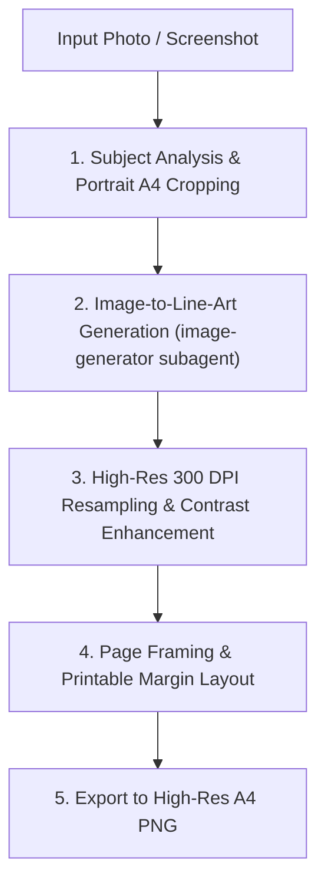

# Photo to Children's Drawing Book Page

This skill guides you through converting any reference photo or screenshot into a high-quality, print-ready A4 children's coloring book page with clean, bold outlines and age-appropriate colorable spaces.

---

## Workflow Overview



> [!IMPORTANT]
> **No Iterative Manual Pixel Retouching**:
> Do NOT spend multiple turns inspecting coordinates, writing custom flood-fill masks, or performing manual pixel cleanup. Once `image-generator` returns the illustration, directly apply Step 3 (contrast enhancement/thresholding), Step 4 (canvas layout and border frame), and Step 5 (PNG export) in a single Python script. Complete the conversion in minimal turns.

---

## Step-by-Step Procedure

### 1. Subject Analysis & Portrait A4 Cropping

1. **Calculate Dimensions & Aspect Ratio**:
   - Standard A4 portrait ratio: $210 : 297 \approx 1 : 1.4142$ (width / height $\approx 0.7071$).
   - Locate the main subject (e.g., child, bike, helmet, action).
   - Frame the subject with breathing room for context (sky, track, ground) while removing distracting peripheral clutter.

2. **Crop Using Python (`PIL`)**:
   ```python
   from PIL import Image

   im = Image.open('source.jpg')
   W, H = im.size

   # Example: calculate target width for A4 ratio based on crop height
   target_h = int(H * 0.85)  # or full H
   target_w = int(target_h * 210 / 297)

   # Center crop around subject center (cx, cy)
   cx, cy = 2850, 1650
   x0 = max(0, min(W - target_w, cx - target_w // 2))
   y0 = max(0, min(H - target_h, cy - target_h // 2))

   crop = im.crop((x0, y0, x0 + target_w, y0 + target_h))
   crop.convert('RGB').save('cropped_subject.jpg', quality=95)
   ```

---

### 2. Line Art Generation via `image-generator` Subagent

Invoke the built-in `image-generator` subagent using image-to-image translation to create kid-friendly coloring line art:

```python
invoke_subagent(
    TypeName="image-generator",
    Role="Coloring Page Illustrator",
    Prompt="""
Please generate a drawing book coloring page based on this cropped image:
Image path: <ABSOLUTE_PATH_TO_CROPPED_IMAGE>

Requirements:
- Style: Children's coloring book page for a 4-year-old.
- Pure black-and-white line art with clean, bold outlines and pure white fill areas.
- No grayscale, no color, no cross-hatching, no photographic noise or complex shading.
- Large, easy-to-color spaces suitable for crayons and thick markers.
- Faithful depiction of key subject details: child's expression, helmet design, clothing, vehicle/bike geometry, and simplified background curves/trees.
- Aspect ratio: portrait (3:4 or 2:3).
- Output: Save the generated image in the artifact directory or workspace as JPG/PNG.
"""
)
```

Wait for the subagent notification containing the final image path.

---

### 3. Post-Processing & High-Resolution (300 DPI) Formatting

Convert the generated image into crisp, print-ready line art at 300 DPI (A4 size: $2480 \times 3508$ pixels):

1. **Lanczos Upscaling**: Rescale the generated image to fit within the printable content area ($2160 \times 2892$ px).
2. **Contrast & Clean Thresholding**: Ensure whites are pure ($255$) and lines are solid rich black ($0$), removing any compression artifacts:
   ```python
   gray = src.convert('L')
   scaled = gray.resize((target_w, target_h), Image.Resampling.LANCZOS)
   cleaned = scaled.point(
       lambda p: 255 if p > 220 else (0 if p < 80 else int((p - 80) * 255 / (220 - 80)))
   )
   ```

---

### 4. Page Framing & Margins

To prevent background lines from ending awkwardly at the margin, apply an authentic drawing-book border frame:
- **Printable Margins**: Leave ~15 mm ($160$ px) left/right and ~20 mm ($308$ px) top/bottom on the $2480 \times 3508$ canvas.
- **Border Frame**: Draw a $6 \text{--} 8$ px solid black rectangle enclosing the illustration area so landscape lines terminate cleanly.

```python
from PIL import Image, ImageDraw

A4_W, A4_H = 2480, 3508
target_w, target_h = 2160, 2892

canvas = Image.new('RGB', (A4_W, A4_H), color=(255, 255, 255))
offset_x = (A4_W - target_w) // 2
offset_y = (A4_H - target_h) // 2

canvas.paste(cleaned.convert('RGB'), (offset_x, offset_y))

# Add clean drawing-book border
draw = ImageDraw.Draw(canvas)
border_width = 8
x0, y0 = offset_x, offset_y
x1, y1 = x0 + target_w, y0 + target_h
for i in range(border_width):
  draw.rectangle([x0 - i, y0 - i, x1 + i, y1 + i], outline=(0, 0, 0))
```

---

### 5. Exporting High-Res A4 PNG

Save the final drawing book image at 300 DPI:

```python
canvas.save('coloring_page_a4.png', 'PNG', dpi=(300, 300))
```

---

## Design Guidelines for Young Children (Ages 3–5)

- **Line Thickness**: Use thick, distinct outlines ($4\text{--}8$ px at 300 DPI) that define clear boundaries for coloring crayons.
- **Simplified Shapes**: Simplify complex mechanical parts (e.g. bike chains, complex spokes, small text) into broad geometric forms.
- **Recognizable Character Features**: Keep helmet shape, unique clothing elements, and happy facial expressions recognizable.
- **Open Backgrounds**: Use friendly rolling landscape lines, simple puffy clouds, and rounded trees rather than intricate textures or foliage.
