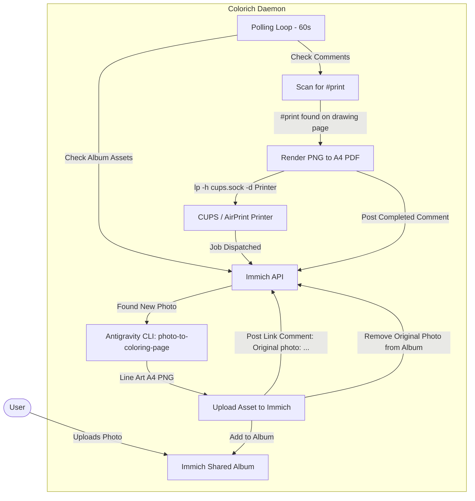

# Colorich: Immich Coloring Book & Print Service

An automated, stateless Kotlin daemon (`colorich`) designed to run in Docker. It continuously monitors an Immich shared album, automatically transforms any uploaded photo into a children's coloring book drawing page (`2480x3508` portrait PNG at 300 DPI) using the Antigravity CLI (`agy`), uploads the line-art page back to the album with a link to the original photo, removes the original photo from the album, and dispatches the page to a CUPS/AirPrint printer whenever a `#print` comment is posted.

---

## Workflow Overview



1. **Automatic Conversion**:
   - Every new still image (`IMAGE` asset type) in the designated shared album is detected by the daemon; videos are skipped. All album pages are scanned, so large albums are fully covered.
   - The daemon runs `agy` with the [`photo-to-coloring-page`](.agents/skills/photo-to-coloring-page/SKILL.md) skill to generate a high-contrast line-art illustration suitable for children (portrait A4 `2480x3508` at 300 DPI, margins, 8px solid border frame).
   - Assets whose filename contains `drawing_book` or `coloring_page`, or that carry an `[original: <UUID>]` comment, are treated as generated pages and are never converted again.
2. **Stateless Linking & Album Management**:
   - The resulting PNG is uploaded to Immich and attached to the shared album.
   - A comment is posted to the new PNG linking back to the original photo:
     `Original photo: <serverUrl>/photos/<originalAssetId> [original: <originalAssetId>]`
   - The original photograph is removed from the shared album (preserving it in Immich while keeping the shared album clean and dedicated to coloring book pages).
   - If the conversion fails, a comment `Failed to convert to drawing book page: <error> [conv-failed: <assetId>]` is posted on the original photo and it will not be retried (also across restarts). Delete that comment to retry.
3. **On-Demand Printing**:
   - When a user comments `#print` (case-insensitive) on a picture in the album, the daemon detects the comment.
   - It immediately acknowledges with `Queued for printing! [ref: <commentId>]`, which marks the request as handled and prevents duplicate prints.
   - The daemon downloads the image, converts it to an A4 PDF via Pillow, and dispatches the print job through the mounted CUPS UNIX domain socket (`/run/cups/cups.sock`) to the AirPrint/network printer queue.
   - When finished it posts `Printed successfully! [ref: <commentId>]` (or `Failed to print: <error> [ref: <commentId>]`).

---

## Configuration (`.env`)

Copy `.env.example` to `.env` and fill in your values:

```bash
cp .env.example .env
```

| Variable | Description | Example / Default |
| :--- | :--- | :--- |
| `IMMICH_SERVER_URL` | Base URL of your Immich instance | `https://immich.example.com` |
| `IMMICH_API_KEY` | Immich API Key (requires download, upload, asset delete & activity permissions) | `your_api_key_here` |
| `IMMICH_SHARED_ALBUM_ID` | UUID of the monitored shared album | `00000000-0000-0000-0000-000000000000` |
| `PRINTER_NAME` | CUPS printer queue name (auto-detected via `lpstat` if omitted) | `My_AirPrint_Printer` |
| `CUPS_SERVER` | CUPS socket path or `host:port` address | `/run/cups/cups.sock` |
| `POLL_INTERVAL_SECONDS`| Polling interval (seconds) | `60` |
| `DRY_RUN` | If `true`, logs print action without dispatching to CUPS | `false` |
| `LOG_LEVEL` | Application log level (`INFO`, `DEBUG`, …), read from the process environment by `logback.xml` | `INFO` |

---

## Required Immich API Key Permissions

Ensure the generated API Key has the following scopes enabled in Immich:
- `asset.read`, `asset.download`
- `asset.upload`, `asset.delete`
- `album.read`, `album.delete` (required to remove assets from an album)
- `activity.read`, `activity.create`

---

## Running with Docker Compose

The service runs non-root (`appuser`, UID:GID `1000:1000`) and mounts the host's CUPS socket and Antigravity credentials:

```bash
docker compose up -d --build
```

### Checking Logs

```bash
docker compose logs -f colorich
```
